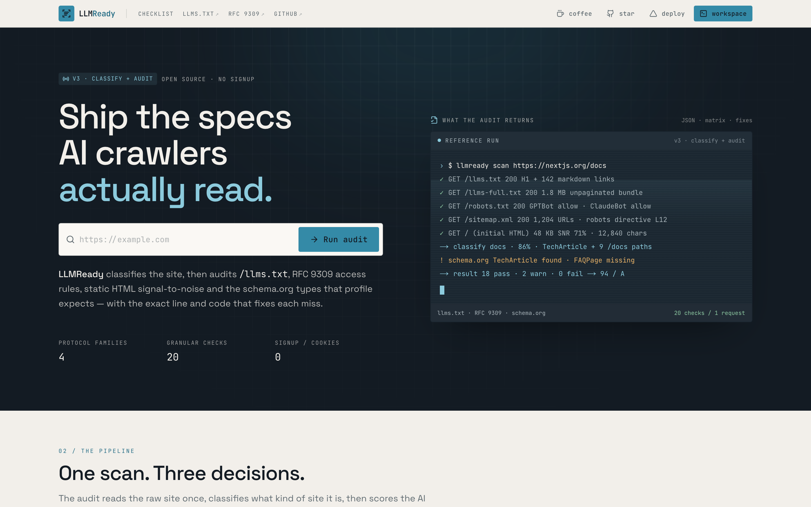
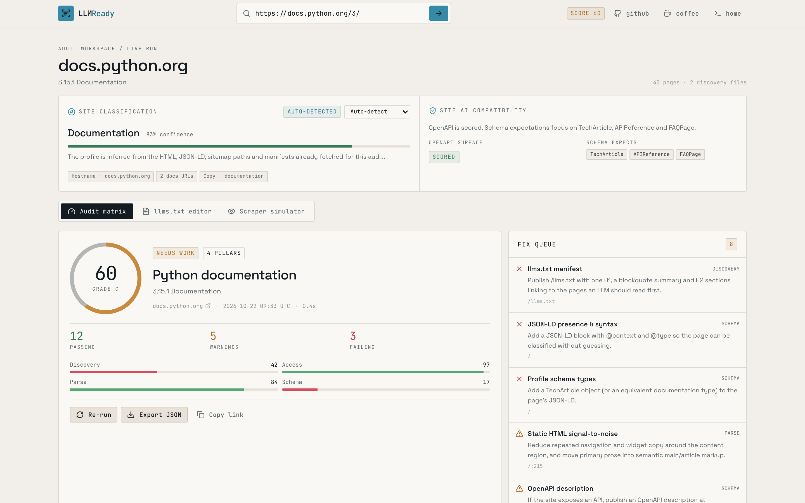
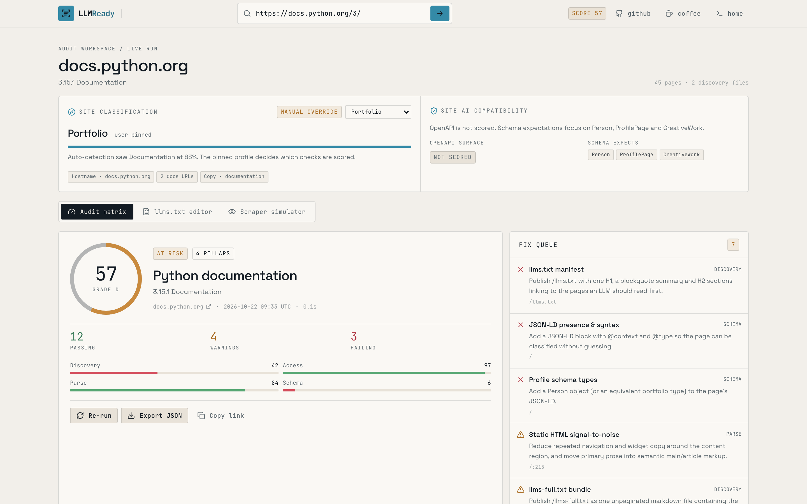
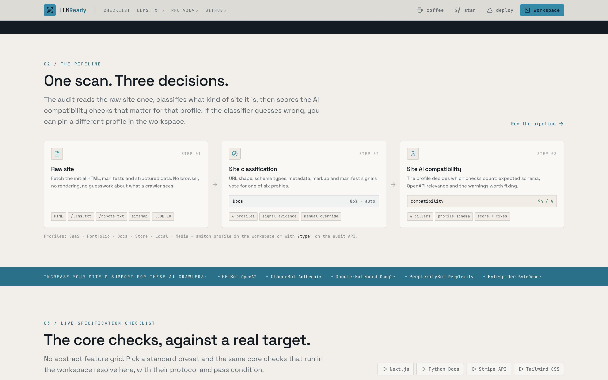
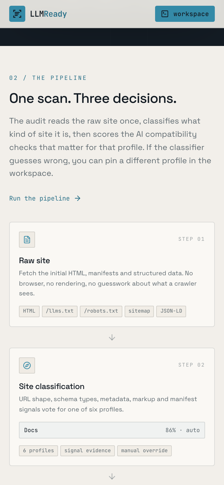
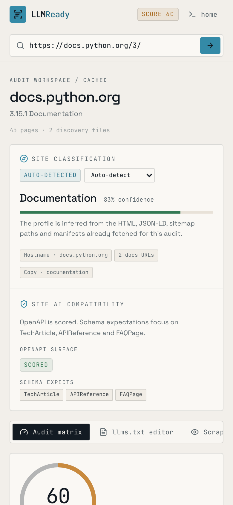

<div align="center">

# LLMReady

**Spec compliance for AI discovery.**

Audit the four things that decide whether an AI crawler can find, read and classify your site: `/llms.txt`, RFC 9309 access rules, static HTML parseability and schema.org metadata. Before the checks run, LLMReady classifies the site into one of six profiles so the audit only scores what matters for that kind of site.

[](https://github.com/ABradwell/llm-seo-toolbox/actions/workflows/ci.yml) [](LICENSE) [](https://github.com/ABradwell/llm-seo-toolbox/commits/main) [](https://github.com/ABradwell/llm-seo-toolbox/issues) [](https://github.com/ABradwell/llm-seo-toolbox/stargazers) [](https://github.com/ABradwell/llm-seo-toolbox/forks)

[](https://nextjs.org) [](https://react.dev) [](https://www.typescriptlang.org) [](https://nodejs.org) [](https://pnpm.io) [](https://vitest.dev) [](https://github.com/ABradwell/llm-seo-toolbox/pulls)

[](https://llm-seo-toolbox.vercel.app) [](public/openapi.json) [](public/llms.txt)

<p>
  <a href="https://vercel.com/new/clone?repository-url=https%3A%2F%2Fgithub.com%2FABradwell%2Fllm-seo-toolbox"></a>
  &nbsp;
  <a href="https://buymeacoffee.com/bradwell"></a>
</p>

</div>

<p align="center">
  
  <br />
  <sub>Landing page · terminal hero, three-step pipeline and a live specification checklist</sub>
</p>

---

## Why this exists

AI answers are assembled from what a crawler can read. If the manifest is missing, `robots.txt` blocks the wrong agent, or the first HTML response is a JavaScript shell, the page does not enter the context window. LLMReady measures that surface without rendering the target and returns the exact source line and a copy-paste fix for every miss.

- **Audit** any public URL against 49 check ids across four protocol pillars: 33 scored checks plus 16 per-crawler access rows that stay visible but carry no weight. The default site score belongs to the origin and samples up to eight pages; `scope=page` keeps the original single-page audit.
- **Author** `/llms.txt` and `/llms-full.txt` from the pages the audit discovered, with live structural validation.
- **See** the focus page's initial HTML next to the markdown an LLM scraper actually reads.

No accounts, no database, no JavaScript execution against the target site.

## Features

### Landing page — `/`

A terminal hero with a quick audit bar. Below it, a **three-step pipeline** shows how the raw site becomes a site classification and then a profile-specific AI compatibility score. Next, the crawler reference strip is followed by the **CLI and GitHub Action** sections, which give copyable install and usage instructions for the terminal and the pull-request gate. The page closes with GitHub, Vercel deploy and Buy Me a Coffee links.

### Workspace — `/app`

Above the tabs, the **site classification panel** shows the detected profile, confidence, the signals behind it and the compatibility rules it applies. When automatic confidence falls below 30%, the profile title is flagged and every option is shown with its own compact confidence bar. The profile select re-runs the audit with a `type` parameter, so an override is shareable and cached separately from the automatic result. A **scope** switch controls whether the score is origin-scoped (the default) or the single-page V2 audit (`scope=page`). Entering a deep link such as `/app/docs/start` sets the focus page for the drill-down; it does not move the site score.

A **view** switch sets how much detail the first tab shows. The default is **plain language**, written for marketers and site owners. Each failing or warning check gets a jargon-free reason, a "tell me more" explainer, who usually does the work, and bullet-point change requests. The **change requests** panel turns the selected items into one copy-paste brief, as markdown that also reads as plain text, for an email, ticket or chat. An optional checkbox adds file locations, findings and fix snippets for the developer. Choosing **technical** (`view=technical`) shows the full audit matrix. Each plain card links to its row in the matrix. The plain copy lives in [`packages/core/src/plain-language.ts`](packages/core/src/plain-language.ts), separate from the check logic.

| Tab                   | What it does                                                                                                                                                                                                                                                                                                          |
| :-------------------- | :-------------------------------------------------------------------------------------------------------------------------------------------------------------------------------------------------------------------------------------------------------------------------------------------------------------------- |
| **What to fix**       | The plain-language view: a grade in plain words, must-fix and worth-improving cards with change requests, a copyable brief for developers, and a list of what already works. Shown when the view is `plain`.                                                                                                          |
| **Audit matrix**      | Shown when the view is `technical`. Site or page score and grade, per-pillar breakdown, every check with pass/warn/fail, the protocol it enforces, the source file and exact line number, sample coverage for aggregated page checks, a prioritized fix queue, discovery file table, and expandable code-level fixes. |
| **Sampled pages**     | The pages that feed the site score, with per-page status, score, outline, static-text, freshness, FAQ and robots signals. Expand a row for its 18 page-level checks. The focus page is shown separately when it was not in the sample.                                                                                |
| **`llms.txt` editor** | Edit the site name, summary and notes, choose discovered sections, then preview `llms.txt` or `llms-full.txt` with line numbers, live validation and copy/download actions.                                                                                                                                           |
| **Scraper simulator** | The focus page's raw HTML beside the cleaned markdown a non-JS crawler would ingest, with payload reduction, token estimates, stripped-element counts and line numbers on both panes.                                                                                                                                 |

## Screenshots

The workspace is the core of the app: classification, scoring and the fix queue on one page.



<table>
  <tr>
    <td width="50%">
      
    </td>
    <td width="50%">
      
    </td>
  </tr>
  <tr>
    <td align="center"><sub>Manual profile override</sub></td>
    <td align="center"><sub>Landing page pipeline</sub></td>
  </tr>
</table>

<p align="center">
  
  &nbsp;&nbsp;
  
  <br />
  <sub>Mobile at 390 × 844 — pipeline and workspace.</sub>
</p>

## Quick start

```bash
git clone https://github.com/ABradwell/llm-seo-toolbox
cd llm-seo-toolbox
pnpm install
pnpm dev
```

Open <http://localhost:3000>, or go straight to <http://localhost:3000/app?url=docs.python.org>.

Requirements: **Node 20.9+** (CI uses Node 22) and **pnpm 10+**.

### Scripts

| Script                | Purpose                                             |
| :-------------------- | :-------------------------------------------------- |
| `pnpm dev`            | Start the development server on port 3000.          |
| `pnpm build`          | Production build.                                   |
| `pnpm start`          | Serve the production build.                         |
| `pnpm build:cli`      | Bundle the `@llm-seo-toolbox/cli` executable.       |
| `pnpm build:action`   | Bundle the GitHub Action into `actions/audit/dist`. |
| `pnpm build:packages` | Build the CLI and the GitHub Action.                |
| `pnpm cli`            | Run the built CLI (`pnpm cli example.com`).         |
| `pnpm lint`           | ESLint over the whole project.                      |
| `pnpm format`         | Prettier write (`format:check` to verify only).     |
| `pnpm screenshots`    | Capture desktop/mobile app screenshots.             |
| `pnpm typecheck`      | `tsc --noEmit`.                                     |
| `pnpm test`           | Vitest unit suite (`test:watch` to iterate).        |

### Configuration

All variables are optional; the app works out of the box.

| Variable                 | Default                                             | Used for                                          |
| :----------------------- | :-------------------------------------------------- | :------------------------------------------------ |
| `NEXT_PUBLIC_SITE_URL`   | Vercel production URL, else `http://localhost:3000` | Canonical metadata, sitemap and robots.txt URLs.  |
| `NEXT_PUBLIC_GITHUB_URL` | `https://github.com/ABradwell/llm-seo-toolbox`      | Header, footer and landing page repository links. |
| `NEXT_PUBLIC_BMC_URL`    | `https://buymeacoffee.com/bradwell`                 | Buy Me a Coffee links in the header and footer.   |

Copy [`.env.example`](.env.example) to `.env.local` to override them.

## CLI

The audit engine is packaged as a small executable so the same checks run in a
terminal, a script or CI. It shares `@llm-seo-toolbox/core` with the web
workspace and the GitHub Action.

```bash
pnpm install
pnpm build:cli

# Run the bundled CLI
pnpm cli example.com

# Equivalent, without the root script
node packages/cli/dist/index.js example.com --format json
```

| Flag                    | Short | Default         | Description                                                                                       |
| :---------------------- | :---- | :-------------- | :------------------------------------------------------------------------------------------------ |
| `--format <type>`       | `-f`  | `table`         | `table`, `json`, `markdown`, `summary` or `brief` (plain-language change requests)                |
| `--min-score <number>`  | `-s`  | `0`             | Composite score required to pass (0–100)                                                          |
| `--min-grade <grade>`   | `-g`  | `F`             | Letter grade required to pass (`A`, `B`, `C`, `D`, `F`)                                           |
| `--site-type <type>`    | `-t`  | `auto`          | Force a profile: `auto`, `saas`, `portfolio`, `docs`, `ecommerce`, `local-business`, `blog-media` |
| `--config <path>`       | `-c`  | auto-discovered | Configuration file to load                                                                        |
| `--output <file>`       | `-o`  | stdout          | Write the report to a file                                                                        |
| `--timeout <ms>`        |       | `10000`         | Per-request timeout                                                                               |
| `--user-agent <ua>`     |       | toolbox default | Override the crawler user agent                                                                   |
| `--header <name:value>` |       |                 | Extra request header; repeat for multiple headers                                                 |
| `--no-resolve-links`    |       | resolve         | Skip the HEAD requests that verify links inside `llms.txt`                                        |
| `--no-agent-fetch`      |       | enabled         | Skip the live GPTBot and OAI-SearchBot firewall comparison                                        |
| `--verbose`             | `-v`  | `false`         | Log progress and timing to stderr                                                                 |
| `--no-color`            |       | TTY-dependent   | Disable ANSI colour (also honours `NO_COLOR`)                                                     |

Exit codes: **0** threshold met, **1** audit completed below a threshold, **2**
the audit could not run (bad arguments, unreachable host, timeout).

### Configuration file

The CLI looks for `llm-seo-toolbox.config.json`, `.llmseotoolboxrc` and
`.llmseotoolboxrc.json` in the working directory, in that order. CLI flags
override file values. Copy [`.llmseotoolboxrc.example`](.llmseotoolboxrc.example)
to get started.

```json
{
  "format": "summary",
  "minScore": 75,
  "minGrade": "B",
  "siteType": "auto",
  "timeout": 10000,
  "resolveLinks": true,
  "agentFetch": true
}
```

Add a `headers` object (or repeat `--header`) when a staging or preview host
needs an extra request header. For example, Vercel's automation bypass uses
`{"headers": {"x-vercel-protection-bypass": "..."}}`.

## GitHub Action

[`actions/audit`](actions/audit/action.yml) wraps the same engine. It audits the
target URL, writes the report to the job summary, posts or updates one sticky
pull request comment, and fails the job when the score or grade misses its
threshold.

```yaml
- name: Build the audit action
  run: pnpm install --frozen-lockfile && pnpm build:action

- name: Audit the production deployment
  uses: ./actions/audit
  with:
    url: https://example.com
    min-score: "80"
    min-grade: "B"
    comment-on-pr: "true"
    github-token: ${{ secrets.GITHUB_TOKEN }}
```

| Input           | Default               | Description                                       |
| :-------------- | :-------------------- | :------------------------------------------------ |
| `url`           | required              | Target URL to audit                               |
| `min-score`     | `75`                  | Minimum composite score required to pass          |
| `min-grade`     | `B`                   | Minimum letter grade required to pass             |
| `site-type`     | `auto`                | Force a profile or keep automatic classification  |
| `comment-on-pr` | `true`                | Create or update the sticky pull request comment  |
| `github-token`  | `${{ github.token }}` | Token used to write the comment                   |
| `timeout`       | `10000`               | Per-request timeout in milliseconds               |
| `report-style`  | `technical`           | `technical` matrix, or `plain` change requests    |
| `resolve-links` | `true`                | Verify up to six links inside `llms.txt`          |
| `agent-fetch`   | `true`                | Compare a live fetch as GPTBot and OAI-SearchBot  |
| `headers`       | none                  | Extra request headers, one `Name: value` per line |

Extra headers are sent only to the audited origin; external links and
cross-origin redirects never receive them.

Outputs: `score`, `grade`, `passed` and `report-json`.

Set `report-style: plain` when the comment is read by people outside engineering. The comment then leads with the pass or fail verdict, followed by the same plain-language change requests as the web app, with technical references for the developer.

The repository dogfoods the action in
[`.github/workflows/llm-seo-toolbox-audit.yml`](.github/workflows/llm-seo-toolbox-audit.yml).
Pull requests audit the Vercel preview deployment for the pull request head
commit, resolved from the Vercel REST API. The workflow waits up to ten minutes
for the deployment to become `READY`, then audits its deployment URL. Pushes to
`main` and manual runs audit `https://llm-seo-toolbox.vercel.app`, or the
`LLM_SEO_TOOLBOX_AUDIT_URL` repository variable when set.

Preview audits need a `VERCEL_TOKEN` repository secret with access to the
project's team, plus `VERCEL_PROJECT_ID` and `VERCEL_TEAM_ID` repository
variables (the team slug falls back to `bradwell-applications`). Preview
deployments for this repository use Vercel Deployment Protection, so add the
`VERCEL_AUTOMATION_BYPASS_SECRET` repository secret as well. The workflow sends
it only to the audited origin, so it is never forwarded to external links in
`llms.txt` or to cross-origin redirects.

Pull requests from forks do not receive repository secrets, so the preview
resolver cannot run. Run the audit from a same-repo branch or locally instead.

## Workspace layout

The auditing engine lives in packages so the web app, CLI and action all run the
same code.

| Path            | What it is                                                          |
| :-------------- | :------------------------------------------------------------------ |
| `packages/core` | Classifier, four-pillar analyzer, scoring and report serialization. |
| `packages/cli`  | `llm-seo-toolbox` command-line wrapper built with tsup.             |
| `actions/audit` | GitHub Action wrapper with threshold gating and PR comments.        |
| `src/lib`       | Thin re-exports the Next.js workspace consumes.                     |

## Site classification

Every audit starts with the raw site. The classifier is deterministic, runs in-process and adds no network requests: it scores signals that were already collected during the scan.

| Profile          | Strong signals                                                                   | Compatibility effect                                   |
| :--------------- | :------------------------------------------------------------------------------- | :----------------------------------------------------- |
| `saas`           | `SoftwareApplication`/`WebApplication`, pricing and feature paths, product CTAs. | OpenAPI scored; `SoftwareApplication` schema expected. |
| `portfolio`      | `Person`/`ProfilePage`, `/work` and case-study paths, portfolio copy.            | OpenAPI not scored; `Person` schema expected.          |
| `docs`           | `TechArticle`/`APIReference`, docs and reference paths, code-block-heavy HTML.   | OpenAPI scored; `TechArticle` schema expected.         |
| `ecommerce`      | `Product`/`Offer`, product and cart paths, add-to-cart or price markup.          | OpenAPI not scored; `Product` schema expected.         |
| `local-business` | `LocalBusiness` subtype, location/service paths, address or phone markup.        | OpenAPI not scored; `LocalBusiness` schema expected.   |
| `blog-media`     | `Article`/`NewsArticle`, blog and author paths, repeated article/time markup.    | OpenAPI not scored; `Article` schema expected.         |

The classifier also reads hostname prefixes (`docs.`, `blog.`, `shop.`, `store.`, `portfolio.`, `app.`), `og:type`, title and description copy, and the `llms.txt` index. The highest additive score wins. The API returns the top signals, a confidence value and the winning profile.

### Override the profile

The workspace select pins a profile for the current URL. The same override is available in the API:

```http
GET /api/audit?url=example.com&type=portfolio
```

Accepted values are `saas`, `portfolio`, `docs`, `ecommerce`, `local-business` and `blog-media`. Omit `type` to classify automatically. Overrides are cached separately from the automatic audit, and the automatic result stays in the response as `classification.detected` so you can see what the heuristics would have chosen.

## Scoring model

### Site score vs page score

The default audit is **site-scoped**. The score belongs to the origin, so `/` and `/docs/start` return the same score and the same sample. The engine builds an inventory from the sitemap and homepage links, selects up to **eight pages deterministically** (homepage first, then one page per section before a second page from any section), and runs the 18 page-level checks across that sample. The URL you entered becomes the **focus page** for the drill-down, but it is not added to the site score unless the sampler already selected it. If it was selected, its existing result is reused.

The engine evaluates **49 check ids**: 33 scored checks plus 16 per-crawler access rows. The bot rows stay visible in the matrix but carry weight `0`, so they never double count against the three intent groups. Fifteen scored checks run once for the origin: the discovery files, feed and markdown mirror, `robots.txt` reachability and AI policy, the search/fetch/training intent groups, the live firewall comparison, `Content-Signal`, entity identity, OpenAPI and `.well-known`. The 18 page-level checks are aggregated by the **mean of their status points** across analyzed pages. Seven of eight pages passing is `87.5 → 88`, so the aggregate is a warning, not a 50-point binary warning. Site scope is the default; `scope=page` restores the single-page hybrid audit, where the entered page's checks are scored directly.

Each scored check returns **pass**, **warn** or **fail**, worth 100, 50 and 0 points. A pillar score is the weighted average of its checks; the overall score is the mean of the four pillars, so every pillar matters equally. Informational checks and zero-weight rows do not contribute. Aggregated page checks carry their mean score in `check.score`; the displayed status uses ≥ 90 pass, ≥ 50 warn, otherwise fail. The scoring model is versioned as `site-2`; cached `site-1` results are not reused.

| Grade | Score  | Label             |
| :---- | :----- | :---------------- |
| A     | 90–100 | LLM-ready         |
| B     | 75–89  | Nearly ready      |
| C     | 60–74  | Needs work        |
| D     | 40–59  | At risk           |
| F     | 0–39   | Invisible to LLMs |

### 1. Discovery & Manifests

`llms-txt`, `llms-full-txt`, `sitemap`, `feed` and `markdown-mirror` are **origin-level** and run once per audit. `freshness` and `canonical` are **page-level** and aggregated across the sample.

| Check             | Weight                                | Passing means                                                                                                                                                                        |
| :---------------- | :------------------------------------ | :----------------------------------------------------------------------------------------------------------------------------------------------------------------------------------- |
| `llms-txt`        | 3                                     | Served as plain text at the root, with one H1, a summary and a markdown link index. Up to six links are resolved; broken or undeclared off-origin links downgrade to warn.           |
| `llms-full-txt`   | 1                                     | A usable, unpaginated bundle. Optional: a missing file is a warning, not a failure.                                                                                                  |
| `sitemap`         | 2                                     | A URL set is discovered at `/sitemap.xml` or a robots-referenced location **and** `robots.txt` contains a `Sitemap:` directive. The detail reports the share of URLs with `lastmod`. |
| `feed`            | 1 blog-media, 0.5 docs/SaaS, 0 others | An RSS, Atom or JSON Feed alternate resolves to a non-HTML body with at least one item. Informational on other profiles.                                                             |
| `markdown-mirror` | 1.5 docs/SaaS, 0 others               | Content negotiation, a `text/markdown` alternate or a `.md` sibling returns markdown whose first heading matches the page H1. Informational on other profiles.                       |
| `freshness`       | 1.5 (2.5 blog-media/docs)             | A machine-readable modified date within 18 months, with the sitemap `lastmod` agreeing within 7 days. Published-only, stale or disagreeing dates warn.                               |
| `canonical`       | 1                                     | An absolute, same-origin canonical that is self-referential or points at a URL in the inventory. Missing or relative warns; off-origin fails.                                        |

Every issue carries a 1-based line number from the fetched response, so the matrix can point at the exact malformed heading, link or directive.

### 2. Crawler Access Rules

`robots.txt` reachability, the explicit AI policy, the three intent groups, the live firewall comparison and `Content-Signal` are **origin-level**. The robots meta tag and `X-Robots-Tag` are **page-level**: each sampled page is checked, then the results are aggregated.

| Check              | Weight | Passing means                                                                                                                       |
| :----------------- | :----- | :---------------------------------------------------------------------------------------------------------------------------------- |
| `robots-reachable` | 1      | The file is served and parses into user-agent groups. A missing file warns.                                                         |
| `ai-policy`        | 1      | At least one AI crawler is named in its own group, making intent auditable.                                                         |
| `access-search`    | 3      | Every search and citation crawler is allowed on every sampled path.                                                                 |
| `access-fetch`     | 2      | Every on-demand fetch agent is allowed on every sampled path.                                                                       |
| `access-training`  | 1      | Every training crawler is named explicitly, whether the group allows or blocks training.                                            |
| `agent-fetch`      | 3      | A live fetch as GPTBot and OAI-SearchBot is not blocked by the firewall. A training-only block warns.                               |
| `content-signal`   | 0.5    | Cloudflare `Content-Signal` values agree with the crawler groups in `robots.txt`.                                                   |
| 16 `bot-<id>` rows | 0      | Per-crawler detail for the 16-agent roster. Visible in the matrix, grouped under search, fetch or training, but never scored twice. |
| `meta-robots`      | 1      | No `noindex` or `none` on the page. Aggregated across the sample.                                                                   |
| `x-robots-tag`     | 2      | The response does not send a blocking header; scoped restrictions are evaluated.                                                    |

RFC 9309 matching is implemented directly: the longest matching path wins, `Allow` wins ties, and both `*` and `$` syntax are supported. Path-aware access is evaluated against every sampled path, so a crawler blocked on `/docs` is not reported as allowed just because `/` is open. Blocking all agents with a wildcard `Disallow: /` is reported per vendor.

### 3. Static Parseability

All ten checks are **page-level**. In site scope they are aggregated across the sample; in `scope=page` they score the entered page directly.

| Check              | Weight                                 | Passing means                                                                                         |
| :----------------- | :------------------------------------- | :---------------------------------------------------------------------------------------------------- |
| `h1`               | 1.5                                    | Exactly one top-level heading inside the content region.                                              |
| `heading-order`    | 2                                      | No skipped levels, and the outline does not start deeper than H1.                                     |
| `snr`              | 2.5                                    | ≥ 65 % of visible text is content signal (warn ≥ 45 %, fail below).                                   |
| `ssr-content`      | 2                                      | ≥ 600 characters of readable text in the initial HTML response (warn ≥ 200) — no JavaScript required. |
| `faq-content`      | 2 where FAQ is expected, 0.5 elsewhere | Three or more visible question-and-answer pairs, with FAQPage markup matching the visible answers.    |
| `answer-first`     | 1.5                                    | A 40–160 word summary paragraph between the H1 and the first H2.                                      |
| `section-chunks`   | 1                                      | H2/H3 sections with an 80–500 word median, so an answer can be quoted without pulling the whole page. |
| `page-metadata`    | 1.5                                    | A title, meta description, `lang` and OpenGraph basics are present and consistent.                    |
| `image-alt`        | 0.5 (1.5 portfolio/ecommerce)          | Meaningful images carry alt text of at least four characters.                                         |
| `citable-evidence` | 0.5 blog-media/SaaS                    | Numeric claims and outbound references give a model something concrete to cite.                       |

**Signal-to-noise ratio (SNR)** is content text divided by content text plus text from repeated chrome: `nav`, `header`, `footer`, `aside`, `role="banner"`, `role="contentinfo"`, `role="complementary"`, consent/cookie widgets and `aria-hidden` nodes. Scripts, styles, SVGs and frames are removed before measurement. A page that is mostly navigation scores low even when it has a lot of total text.

The content region is `main`, else `[role="main"]`, else the richest `article`, else `body` — and a region that only holds a teaser falls back to the whole document. Headings and the SNR source line are extracted with parse5 source locations, so the evidence points at the line in the original HTML response.

### 4. Structured Machine Interfaces

`json-ld`, `schema-types`, `schema-depth` and `breadcrumbs` are **page-level** and aggregated across the sample. `entity-identity`, OpenAPI and `.well-known` discovery are **origin-level** and run once.

| Check             | Weight | Passing means                                                                                                                                                            |
| :---------------- | :----- | :----------------------------------------------------------------------------------------------------------------------------------------------------------------------- |
| `json-ld`         | 2.5    | At least one JSON-LD block parses, with `@context`/`@type` when present. Microdata and RDFa are also detected and reported.                                              |
| `schema-types`    | 1.5    | One of the profile's required types is present — e.g. `TechArticle` for docs, `Product` for e-commerce.                                                                  |
| `schema-depth`    | 1.5    | The matching type fills the properties a model needs, such as `author`, `dateModified` and `publisher` for an article.                                                   |
| `breadcrumbs`     | 0.5    | Pages two or more segments deep publish a `BreadcrumbList` whose last item points at the page.                                                                           |
| `entity-identity` | 2.5    | The homepage and company pages expose a consistent `Organization` or `Person` identity with `sameAs` links.                                                              |
| `openapi`         | 1.5    | `/openapi.json`, `/.well-known/openapi.json`, `/openapi.yaml` or an `application/linkset+json` API catalog points at an OpenAPI document. Scored only for SaaS and docs. |
| `well-known`      | 0.5    | `security.txt` is valid, and SaaS/docs sites publish an API catalog at `/.well-known/api-catalog`.                                                                       |

## API

```http
GET /api/audit?url=example.com
GET /api/audit?url=example.com/docs/start
GET /api/audit?url=example.com&scope=page
GET /api/audit?url=example.com&type=docs
```

`url` accepts a bare domain or a full URL; missing schemes default to `https://`. `scope` is `site` by default and samples up to eight pages from the origin. Pass `scope=page` for the single-page V2 audit. `type` is optional and pins the site profile instead of using automatic classification.

The site score is origin-scoped: `finalUrl` is the site root, `focusUrl` is the page you entered, and `pageResults` holds the sampled pages that produced the score. The focus page is returned separately as `focusPage`; it only contributes to the score when the deterministic sample includes it. `coverage` explains the inventory, sample and any failures or deadline truncation.

```jsonc
{
  "scope": "site",
  "url": "https://example.com/docs/start",
  "finalUrl": "https://example.com/",
  "focusUrl": "https://example.com/docs/start",
  "domain": "example.com",
  "score": 78,
  "grade": "B",
  "gradeLabel": "Nearly ready",
  "classification": {
    "type": "docs",
    "label": "Documentation",
    "confidence": 86,
    "method": "heuristic",
    "detected": { "type": "docs", "label": "Documentation", "confidence": 86 },
    "alternatives": [
      { "type": "docs", "label": "Documentation", "confidence": 86 },
      { "type": "saas", "label": "SaaS / product", "confidence": 12 },
      // …the other four profiles, ranked by automatic support
    ],
    "signals": [
      {
        "type": "docs",
        "label": "Structured data · TechArticle",
        "detail": "JSON-LD declares TechArticle, which is characteristic of this profile.",
        "weight": 16,
        "source": "structured-data",
      },
    ],
    "compatibility": {
      "openApiScored": true,
      "recommendedSchema": ["TechArticle", "APIReference", "FAQPage"],
      "note": "OpenAPI is scored. Schema expectations focus on TechArticle, APIReference and FAQPage.",
    },
  },
  "pillars": [
    {
      "id": "discovery",
      "name": "Discovery & Manifests",
      "shortName": "Discovery",
      "description": "Can an agent find a curated, standards-compliant index of the content?",
      "score": 92,
      "checks": [
        {
          "id": "llms-txt",
          "label": "llms.txt manifest",
          "status": "pass",
          "summary": "Valid · 61 links",
          "detail": "A top-level heading and 61 markdown links were found.",
          "protocol": "llmstxt.org · H1 + markdown index",
          "evidence": {
            "file": "/llms.txt",
            "line": 1,
            "snippet": "# Example Docs",
          },
          "weight": 3,
          "scope": "site",
        },
      ],
    },
  ],
  "profile": { "title": "…", "description": "…", "siteName": "…", "language": "en" },
  "pages": [{ "url": "…", "label": "Docs", "section": "Docs", "source": "sitemap" }],
  "pageResults": [
    {
      "url": "https://example.com/",
      "finalUrl": "https://example.com/",
      "label": "Home",
      "section": "Home",
      "source": "home",
      "outcome": "analyzed",
      "status": "pass",
      "score": 94,
      "grade": "A",
      "checks": [{ "id": "h1", "status": "pass", "scope": "page" }],
      "title": "Example",
      "textChars": 1840,
      "snr": 0.82,
      "h1Count": 1,
      "headingCount": 9,
      "jsonLdTypes": ["SoftwareApplication"],
      "metaRobots": "",
      "xRobotsTag": null,
    },
  ],
  "focusPage": {
    "url": "https://example.com/docs/start",
    "finalUrl": "https://example.com/docs/start",
    "outcome": "analyzed",
    "score": 89,
    "source": "focus",
  },
  "coverage": {
    "method": "sitemap",
    "inventorySize": 146,
    "listedPages": 80,
    "sampleSize": 8,
    "analyzedPages": 8,
    "failedPages": 0,
    "skippedPages": 138,
    "sitemapFound": true,
    "homepageFallback": false,
    "truncated": true,
    "deadlineHit": false,
    "note": "Analyzed 8 of 146 pages from the sitemap.",
  },
  "files": [
    {
      "id": "robots-txt",
      "label": "robots.txt",
      "path": "/robots.txt",
      "url": "https://example.com/robots.txt",
      "found": true,
      "statusCode": 200,
      "bytes": 812,
      "note": "Found",
    },
  ],
  "vision": {
    "rawHtml": "…",
    "markdown": "…",
    "htmlBytes": 184320,
    "markdownBytes": 21400,
    "reductionPct": 88,
    "tokenEstimate": { "html": 46800, "markdown": 5400 },
    "removed": { "scripts": 12, "styles": 4, "landmarks": 6, "svg": 18, "frames": 1 },
    "rawTruncated": true,
    "markdownTruncated": false,
  },
  "fixes": [
    {
      "checkId": "json-ld",
      "pillarId": "structured",
      "pillarName": "Schema",
      "label": "JSON-LD presence & syntax",
      "status": "fail",
      "summary": "Missing",
      "recommendation": "Add a JSON-LD block with @context and @type…",
      "evidence": { "file": "/", "line": null, "snippet": null },
      "fix": { "language": "json", "code": "{ \"@context\": \"https://schema.org\" }" },
      "weight": 2,
      "scope": "page",
      "sample": {
        "total": 8,
        "passed": 3,
        "warned": 1,
        "failed": 4,
        "affected": ["https://example.com/", "https://example.com/pricing"],
      },
    },
  ],
  "meta": {
    "fetchMs": 1420,
    "pageCount": 80,
    "discoveredPageCount": 146,
    "sampledPageCount": 8,
    "crawledAt": "2026-01-01T00:00:00.000Z",
    "cached": false,
    "siteCached": false,
    "focusCached": false,
    "scoringVersion": "site-2",
  },
}
```

`evidence.line` is the 1-based line in the fetched source when one exists. `fix.language` is one of `markdown`, `robots`, `html`, `json`, `http`, `yaml` or `text`.

Errors are returned as `{ "error": { "code", "message", "hint?" } }`.

| Status | Code                | Meaning                                                                |
| :----- | :------------------ | :--------------------------------------------------------------------- |
| 400    | `missing_url`       | No `url` query parameter.                                              |
| 400    | `invalid_url`       | The URL is longer than 2048 characters.                                |
| 400    | `invalid_site_type` | `type` is not one of the six accepted profile ids.                     |
| 400    | `invalid_scope`     | `scope` is not `site` or `page`.                                       |
| 400    | `blocked_url`       | Private, loopback or reserved host, or an unsafe redirect target.      |
| 415    | `not_html`          | The URL returned something that is not an HTML page.                   |
| 429    | `rate_limited`      | The weighted 30-credit minute is exhausted (`retry-after` is set).     |
| 500    | `internal_error`    | Unexpected failure.                                                    |
| 502    | `fetch_failed`      | Timeout, DNS failure or connection error.                              |
| 502    | `http_error`        | The target answered with 4xx/5xx (`403` usually means bot protection). |

Behaviour notes:

- **Cache:** the audit engine keeps three cache entries, all held for 5 minutes per server instance: the origin base (classification, discovery, inventory and sampled results), the focus page, and a page-scope result. `meta.siteCached` and `meta.focusCached` show which parts were reused; `meta.cached` is true only when the whole request was a hit, and `x-audit-cache` repeats that as a header.
- **Rate limit:** a shared 30-credit window per IP, sliding in memory. A page audit costs 1 credit and a site audit costs 3, because it fetches and analyzes a sample. Denied requests do not consume credits.
- **Duration:** the route declares `maxDuration = 60`. The sampler uses eight pages, concurrency 4, a 6-second per-page timeout and a 25-second sampling deadline. Page scope usually returns in a few seconds; a full site sample usually finishes well inside the function limit.
- **Scope header:** `x-audit-scope` repeats the effective `site` or `page` value on every successful response.
- **User agent:** `LLMReadyBot/0.1 (+https://github.com/ABradwell/llm-seo-toolbox; automated LLM-readiness audit)`.

### Discovery surface

The deployment practices what it audits. These files are generated from the same site URL used for canonical metadata:

| File                          | Source                            | Purpose                                                             |
| :---------------------------- | :-------------------------------- | :------------------------------------------------------------------ |
| `/robots.txt`                 | `src/app/robots.ts`               | Wildcard plus named AI crawler groups, with a `Sitemap:` directive. |
| `/sitemap.xml`                | `src/app/sitemap.ts`              | Canonical URLs for the landing page and workspace.                  |
| `/openapi.json`               | `public/openapi.json`             | OpenAPI 3.1 description of `GET /api/audit`.                        |
| `/.well-known/security.txt`   | `public/.well-known/security.txt` | RFC 9116 security contact and expiry.                               |
| `/llms.txt`, `/llms-full.txt` | `public/`                         | Curated index and full context bundle for agents.                   |

## How the engine works

1. **Validate the target.** Only `http`/`https` on ports 80/443. The hostname is resolved and checked against loopback, private, link-local, multicast and reserved ranges (IPv4 and IPv6), plus blocked TLDs such as `.local` and `.internal`.
2. **Fetch politely.** Redirects are followed manually (max 5) and every hop is re-validated, so a public host cannot bounce the request into your network. Responses are capped by byte ceiling and timeout, `no-store`, with a descriptive user agent.
3. **Anchor the site.** The site root is the seed for a site audit. If the root does not return HTML and the user entered a deeper page, that page replaces the seed and `coverage.homepageFallback` records it.
4. **Read the discovery surface.** `robots.txt`, `llms.txt`, `llms-full.txt`, `sitemap.xml` (indexes are expanded, with a fetch budget), `/openapi.json` or `/.well-known/api-catalog`, and `/.well-known/security.txt` — concurrently. The homepage's advertised feed and markdown mirror are checked in the same pass.
5. **Validate the manifests.** `llms.txt` is parsed for one H1, a blockquote summary, H2 sections, markdown links and pagination markers. Invalid files fail; missing optional files warn.
6. **Build the inventory.** Sitemap URLs come first, then same-origin homepage links that look like pages. Navigation query strings, asset extensions and utility prefixes are filtered. The editor keeps the first 80 URLs; `coverage.inventorySize` records the full count.
7. **Select the sample.** The homepage is always included. The rest are picked deterministically one per section before a second page from any section, up to eight pages. **Focus selection never reads the URL the user entered**, so `/` and `/docs/start` produce the same sample.
8. **Classify the site.** Hostname, sitemap and navigation paths, JSON-LD, `og:type`, copy, markup and `llms.txt` vote for one of six profiles — no extra requests. The winning profile sets expected schema types and whether OpenAPI is scored.
9. **Analyze the sample.** Page-level checks run with concurrency 4, a 6-second per-page timeout and a 25-second sampling deadline. Failed pages stay in `pageResults` with an outcome, but do not contribute observations to the aggregate.
10. **Resolve the focus page.** If it was selected, its sampled result is reused. Otherwise it gets a separate drill-down fetch, which can fail without affecting the site score. `focusPage` always represents the entered page.
11. **Aggregate and score.** Origin checks run once; page checks are averaged by status points, then the four pillars and prioritized fix queue are assembled. `scope=page` skips sampling and scores the entered page directly.
12. **Build the LLM view.** The focus page's cleaned content becomes the simulator markdown and the `llms-full.txt` draft source.

Because nothing is rendered in a browser, the audit reports what is **in the initial HTML response** — exactly what a non-JS crawler sees. Client-rendered content is reported as such rather than silently scored as missing.

## Project structure

```text
.
├── .github/workflows/       # CI: format, lint, typecheck, tests, build, secret scan
├── .husky/pre-commit        # lint-staged + gitleaks
├── actions/audit/           # GitHub Action wrapper with thresholds and PR comments
├── gameplans/               # Product & architecture specification
├── packages/
│   ├── core/                # Shared audit engine used by the web app, CLI and action
│   │   └── src/
│   │       ├── analyzer.ts  # Scope-aware orchestration, caches and origin-level checks
│   │       ├── crawlers.ts  # 16-crawler roster with training, search and fetch intent
│   │       ├── sampling.ts  # Inventory, deterministic sample, bounded concurrency
│   │       ├── page-audit.ts # Per-page extraction and 18 page-level checks
│   │       ├── aggregate.ts # Mean-status aggregation for page-level checks
│   │       ├── metadata.ts  # One head pass: title, description, canonical, dates, feeds
│   │       ├── structured-data.ts # JSON-LD, microdata and RDFa extraction
│   │       ├── schema-depth.ts    # Required-property depth for the matched type
│   │       ├── entities.ts        # Organization and Person identity signals
│   │       ├── faq.ts       # Visible question-and-answer detection
│   │       ├── dates.ts     # Machine-readable freshness signals
│   │       ├── agent-fetch.ts # GPTBot vs OAI-SearchBot firewall comparison
│   │       ├── classifier.ts# V3 site-profile classifier and confidence scoring
│   │       ├── score.ts     # Weighting and grades
│   │       └── …            # Content, directives, robots, sitemap, security
│   └── cli/                 # llm-seo-toolbox command-line wrapper
├── public/                  # Static assets and machine-readable docs
└── src/
    ├── app/
    │   ├── page.tsx         # Landing: terminal hero, pipeline, CLI + action install
    │   ├── app/page.tsx     # Workspace shell
    │   ├── api/audit/       # Analysis endpoint
    │   ├── layout.tsx
    │   └── globals.css      # Tailwind v4 zinc theme, 4px radius scale
    ├── components/
    │   ├── landing/         # Terminal hero, pipeline, CLI + action install, header/footer
    │   ├── workspace/       # Classification, audit matrix, sampled pages, editor, simulator
    │   └── ui/              # Low-radius shadcn-style primitives
    ├── lib/                 # Thin core re-exports plus web-only helpers
    │   ├── analyzer.ts      # Re-export of @llm-seo-toolbox/core
    │   ├── score.ts         # Re-export of core scoring
    │   ├── sitemap.ts       # Re-export of core sitemap helpers
    │   └── …                # Rate limit, pipeline copy, presets, utilities
    └── types/audit.ts       # Re-export of core audit types
```

## Testing

`pnpm test` runs the Vitest suite over the pure helpers and the orchestration path — RFC 9309 parsing, path-aware agent decisions with source lines, `Content-Signal`, sitemap parsing and index expansion, SSRF validation, scoring, `llms.txt` validation, link resolution and coverage, directive evaluation, site classification, metadata extraction, structured-data formats and schema depth, entity identity, visible FAQ detection, freshness signals, the agent firewall comparison, and the content model (scope selection, chrome removal, heading lines, SNR) — on fixtures, with no network access.

The site-scoped suite also covers deterministic stratified sampling, bounded concurrency, mean-status aggregation (`7/8` pass becomes `88` / warn), per-page extraction, weighted rate-limit costs, the 14-step pipeline copy, and a full `analyzeSite` run with mocked fetches that proves `/` and `/docs/app` return the same sample and site score while resolving different focus pages.

Live audits are not part of the suite. To check the engine against real sites, run `pnpm start` and request `/api/audit?url=…`, or use the standard presets in the workspace.

## Screenshot capture

The README images live in [`screenshots/readme/`](screenshots/readme). They were captured from a production build so the Next.js development indicator is not included.

`pnpm screenshots --out "$TMPDIR/llm-ready-screenshots"` drives a locally installed Chrome through the DevTools Protocol. It captures the landing page and pipeline at 1440×900 and 390×844, then the workspace with automatic classification and a portfolio override. Run `pnpm build && pnpm start` first, then pass `--base-url` if the app is not on port 3000.

Options: `--base-url`, `--out`, `--audit-url`, `--chrome` (or `CHROME_PATH`), `--scale` and `--config`. A custom config is a JSON array (or `{ "jobs": [...] }`) of jobs with `name`, `path`, `width`, `height`, `mobile`, `deviceScaleFactor`, `fullPage`, `scrollTo`, `waitForText`, `waitForSelector`, `settleMs` and `timeoutMs`.

## Deployment (Vercel)

1. Push the repository to GitHub.
2. Import the project at [vercel.com/new](https://vercel.com/new) — or click the **Deploy with Vercel** button above.
3. Framework preset **Next.js**, install command `pnpm install`, build command `pnpm build` are detected automatically.
4. Optionally set `NEXT_PUBLIC_SITE_URL`, `NEXT_PUBLIC_GITHUB_URL` and `NEXT_PUBLIC_BMC_URL` in **Project → Settings → Environment Variables**.
5. Deploy.

Notes for production deployments:

- The rate limiter and audit cache live in instance memory. That is fine for a public demo; for stricter global limits, back them with Vercel KV/Upstash Redis and a shared cache.
- The audit route samples up to eight pages, so keep a serverless function timeout of at least 30 seconds where the plan allows it; the route declares `maxDuration = 60`.
- Because the endpoint fetches arbitrary public URLs on demand, keep it on a plan with abuse protections and consider adding a WAF rule or origin allowlist if you run it at scale.

## Code quality & security tooling

- **Husky + lint-staged** — staged files are formatted with Prettier and fixed with ESLint on every commit (`--max-warnings=0`).
- **Gitleaks** — the pre-commit hook runs `gitleaks git --pre-commit --staged` with [`.gitleaks.toml`](.gitleaks.toml) and skips with a warning if the binary is not installed. CI runs the full scan with `gitleaks-action`.
- **CI** — format check, lint, typecheck, unit tests and a production build on every push and pull request.

## Support the project

<p align="center">
  <a href="https://buymeacoffee.com/bradwell">
    
  </a>
</p>

If LLMReady helped you get your site cited:

- ⭐ Star the repository — it is the cheapest way to help others find it.
- ☕ [Buy me a coffee](https://buymeacoffee.com/bradwell) — the same link is wired into the app header and footer via `NEXT_PUBLIC_BMC_URL`.

## Contributing

Issues and pull requests are welcome. Run `pnpm format && pnpm lint && pnpm typecheck && pnpm test && pnpm build` before opening a PR, and add a fixture-based test for any new check.

## License

[GPL-3.0](LICENSE) © LLMReady contributors.
